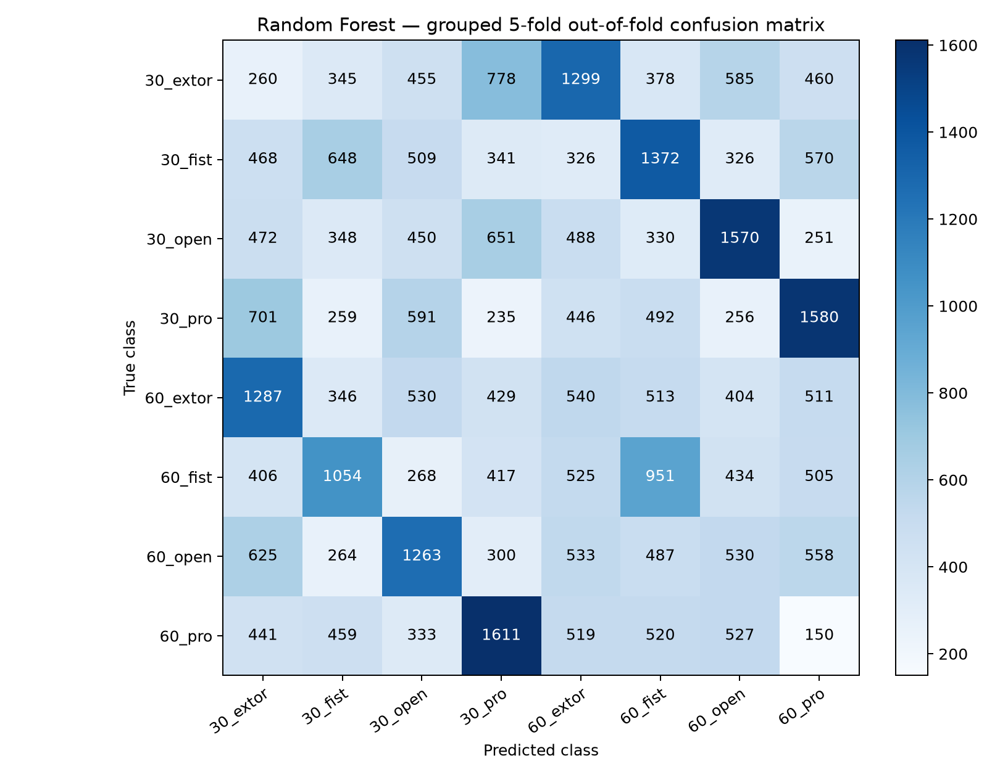
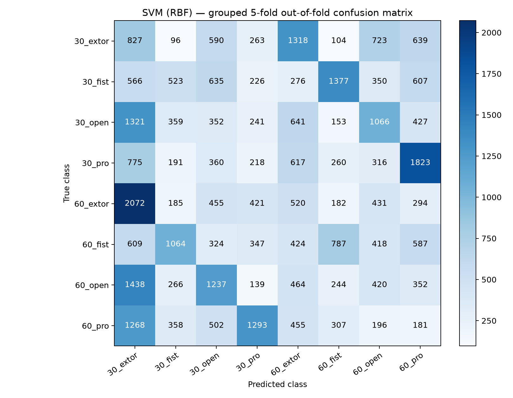
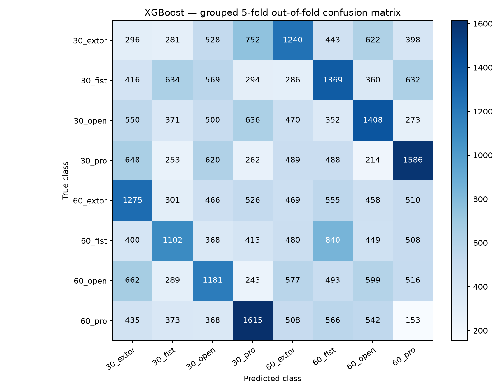

# Grouped five-fold cross-validation

All windows from one source CSV stay in one fold. The scaler is fit separately in each fold.
The accessible article preview does not specify the fold unit; this is not claimed as an exact reproduction.

| Model | Accuracy (mean ± SD) | Macro Precision (mean ± SD) | Macro Recall (mean ± SD) | Macro F1 (mean ± SD) |
|---|---:|---:|---:|---:|
| Random Forest | 10.33% ± 1.50% | 10.46% ± 1.41% | 10.91% ± 0.72% | 10.30% ± 1.03% |
| SVM (RBF) | 10.58% ± 3.20% | 12.00% ± 3.02% | 11.18% ± 2.64% | 10.27% ± 2.47% |
| XGBoost | 10.31% ± 1.85% | 10.49% ± 2.29% | 10.64% ± 1.46% | 10.11% ± 1.75% |

## Pooled out-of-fold confusion matrices

### Random Forest

### SVM (RBF)

### XGBoost

