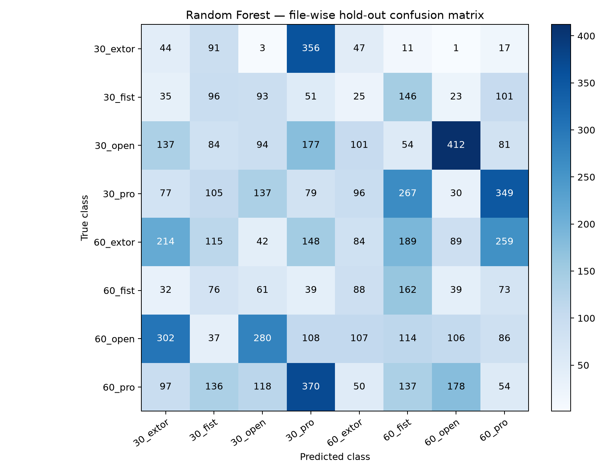
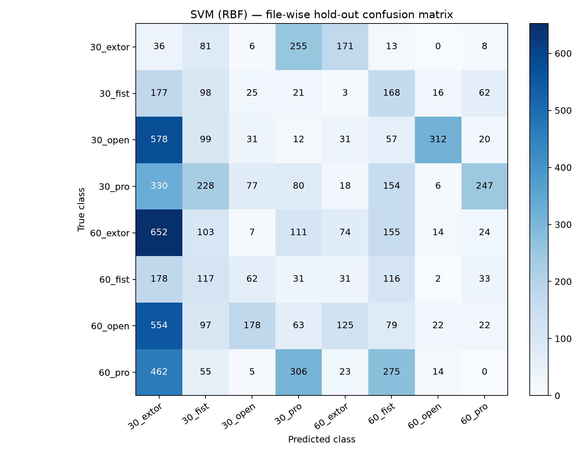
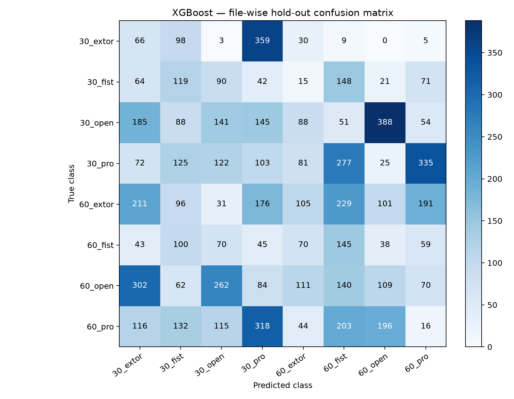

# Model comparison results

Evaluation: fixed stratified source-CSV 80/20 hold-out. Windows from one CSV remain in the same split.

Train windows: 29,070 | Test windows: 7,410

| Model | Accuracy | Macro Precision | Macro Recall | Macro F1 |
|---|---:|---:|---:|---:|
| Random Forest | 0.0970 | 0.1017 | 0.1120 | 0.1016 |
| SVM (RBF) | 0.0617 | 0.0776 | 0.0775 | 0.0678 |
| XGBoost | 0.1085 | 0.1144 | 0.1243 | 0.1117 |

## Confusion matrices

### Random Forest

### SVM (RBF)

### XGBoost

